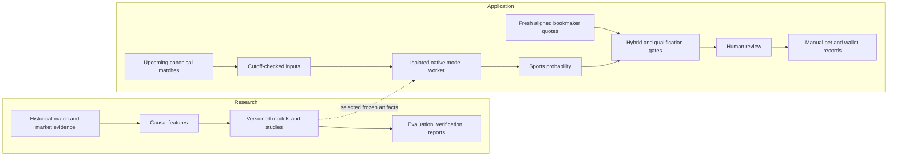

# LoL-Breaker

LoL-Breaker is a League of Legends forecasting and research project: causal pre-match series probabilities, tournament simulation, draft and prop-distribution studies, and a FastAPI/React application for odds review and manual bet tracking. **It does not place bets automatically.**

> **Evidence status:** the configured local sports model is a historical-development candidate, not a promoted or prospectively certified model. The project has not established general bookmaker superiority, a live betting edge, or reliable ±2 percentage-point EV calibration. Local configuration is not deployment.

## What the project contains

- **Pre-match forecasting:** sports-only BO1/BO3/BO5 series probabilities from player history and regional context.
- **Market review:** compare forecasts with timestamped or archived bookmaker prices; a separate fixed 50/50 logit hybrid is evaluated on its own cohort.
- **Manual betting records:** review offers and track manually entered bets, wallet activity, and settlements. No automated bet placement.
- **Tournament simulation:** simulate brackets and tournament formats from match probabilities; exact, hybrid, and Monte Carlo methods are separate integration choices, not tournament-quality guarantees.
- **Draft research:** predict champion picks and post-draft outcomes. Post-draft forecasts require locked-in draft information; they are not pre-match forecasts.
- **Standalone props research:** historical distributions for Map 1 kills, Map 1 duration, and series map count. These research bundles are not live feature adapters or a joint/parlay probability model.

Research results are kept separate from application-serving identities. See the [model catalog](docs/MODEL_CATALOG.md) and [research journal](docs/RESEARCH.md) for each study's status.

## Match-model evidence

The configured local identity is **C20R**, serving version `c0-native-fresh20-2026-10-21-v1-regional-v1` (see [`conf/base/c0_serving.json`](conf/base/c0_serving.json)). The table scores the frozen 2026 assessment on **3,083 regional-supported series**; 20 of 3,103 assessment rows lack regional support and are not imputed.

| Model | Series | Log loss ↓ | Brier ↓ | ECE-10 |
|---|---:|---:|---:|---:|
| Annual A0 | 3,083 | 0.5382 | 0.1821 | 2.3% |
| Historical C0 | 3,083 | 0.5369 | 0.1816 | 2.3% |
| Fresh20 without regional | 3,083 | 0.5354 | 0.1809 | 2.1% |
| **C20R** (fresh20 + regional) | **3,083** | **0.5330** | **0.1800** | **1.9%** |

This is an exposed historical development comparison. C20R failed required BO5/LPL replacement guards and is **not adopted**; lower aggregate loss does not establish a general improvement.

## Model versus bookmaker prices

Matched fixtures, labels, and orientations. Negative ΔLL favors the sports model. “First observed” and “last retained” are recorded endpoints—not authenticated market open/close prices.

| Source | Endpoint | Fixtures | Sports LL | Market LL | Sports − market ΔLL CI |
|---|---|---:|---:|---:|---:|
| OddsPortal | First observed | 9,132 | 0.5834 | 0.5870 | [-0.0085, +0.0014] |
| OddsPortal | Last retained | 9,805 | 0.5826 | 0.5779 | [+0.0009, +0.0085] |
| Pinnacle | First observed | 1,040 | 0.5588 | 0.5789 | [-0.0424, +0.0013] |
| Pinnacle | Last retained | 993 | 0.5606 | 0.5487 | [-0.0171, +0.0312] |

OddsPortal intervals are nominal 95%; Pinnacle intervals are 98.75% family-adjusted for four primary contrasts. These are historical endpoint comparisons, not authenticated open/close evaluations.

| Policy | Fixtures | Log loss | ΔLL vs consensus (95% CI) |
|---|---:|---:|---:|
| C20R | 400 | 0.5850 | [-0.0192, +0.0190] |
| Other-book consensus | 400 | 0.5803 | Reference |
| **Hybrid-50** | 400 | **0.5762** | **[-0.0160, +0.0029]** |

The Polish leave-one-out consensus requires at least two distinct other books. Hybrid-50’s interval crosses zero. These results do not establish bookmaker superiority or betting profitability.

## How the system fits together



## Repository map

| Path | Purpose |
|---|---|
| `src/` | Research models, causal feature banks, tournament engines, and analysis |
| `betting_app/` | FastAPI app, model worker, persistence, quote gates, wallets, scrapers, scheduler, and tests |
| `client/` | React interface |
| `scripts/` | Research CLIs, saved-evidence replay, and verification tools |
| `conf/` | Serving and benchmark contracts |
| `data/` | Local study inputs, model artifacts, outputs, and receipts; usually gitignored |
| `docs/` and `reports/` | Current navigation, reproducibility instructions, research status, and dated evidence |

The DVC pipeline is a retained historical workflow; it is not the entry point for every current study. Start with [`scripts/README.md`](scripts/README.md) before running a research CLI.

## Recreate the numbers above

The numeric scorecards above are generated by the saved-evidence replay. It reads bound local artifacts, checks their hashes and saved reference results, and writes a new `project_summary.json` plus a replay receipt. It does **not** fit models, run neural inference, scrape, access a database, or use the network.

```bash
.venv/bin/python scripts/reproduce_project_results.py \
  --output-dir /tmp/lol-breaker-readme-replay
```

The output fields behind the README tables:

- Model scorecard: `model_scores.regional_supported_3083`
- OddsPortal and Pinnacle table: `bookmaker_comparisons.{oddsportal,pinnacle}.endpoints`
- Polish panel: `bookmaker_comparisons.polish.scores` and `.contrasts`

The command requires the bound local files listed in [reproduction prerequisites](docs/REPRODUCING.md#required-artifacts-and-evidence-checking); they are not all in Git. [`docs/results/project_summary.json`](docs/results/project_summary.json) is the checked-in reference snapshot, not a fallback input. Reproduction verifies saved-output consistency, not source-clock authenticity, actual forecast issuance, executable fills, or prospective performance.

## Start here

- [Project report and quantitative results](docs/PROJECT_REPORT.md)
- [Research status and dated findings](docs/RESEARCH.md)
- [Model identities and study status](docs/MODEL_CATALOG.md)
- [Architecture and data flow](docs/PROJECT_ARCHITECTURE.md)
- [Reproduction requirements and evidence boundaries](docs/REPRODUCING.md)
- [Application setup and safety boundaries](betting_app/README.md)
- [Data provenance catalog](docs/DATA_CATALOG.md)

MIT licensed. Research and education only; not financial advice. LoL-Breaker is not endorsed by Riot Games.
