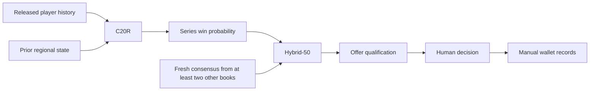

# Architecture

LoL-Breaker combines historical modeling and evaluation with a local application for manual match and betting analysis. The application does **not** place bets automatically. Local configuration is not evidence of a deployment or financial performance.

## Model and decision flow

Missing rosters, clocks or artifacts can prevent a prediction. C20R is a documentation name, not a runtime selector; see the [serving configuration](../conf/base/c0_serving.json). A current market comparison is not closing-line value, and qualification is not proof of profitability.

See the [model catalog](MODEL_CATALOG.md) and [application guide](../betting_app/README.md) for identities, feature modes, operational prerequisites and policy limitations. Historical same-book shrinkage scenarios are not this application's two-other-book hybrid.

## Code map

| Area | Entry points | Purpose |
|---|---|---|
| Native model | [Serving configuration](../conf/base/c0_serving.json), [registry](../betting_app/core/models/registry.py), [native adapter](../betting_app/core/models/native_c0.py) | Model identity, local configuration and native inference |
| Inference | [Inference service](../betting_app/services/c0_inference.py), [worker](../betting_app/services/c0_worker.py) | Isolated model worker and prediction requests |
| Market and policy | [Quote service](../betting_app/services/prematch_quote_service.py), [qualification service](../betting_app/services/bet_qualification_service.py) | Quote context, consensus and eligibility |
| API and interface | [API](../betting_app/api/), [client](../client/) | FastAPI backend and React interface |
| Research | [Models](../src/models/), [analysis](../src/analysis/), [scripts](../scripts/README.md) | Historical experiments, benchmarks and reproducibility interfaces |
| Data | [Data catalog](DATA_CATALOG.md), [DVC pipeline](../dvc.yaml) | Source contracts and retained research pipeline |

## Data and operational boundaries

Model checkpoints, history caches, source data and generated receipts under `data/` are local artifacts, not generally GitHub files. Follow the [reproduction guide](REPRODUCING.md) for dependencies and data access. Retained outputs and frozen study directories should not be overwritten.

A local model setting does not verify live source permissions, authentic roster or quote clocks, forecast issuance, execution prices or a deployed server. The app setup guide describes database and Compose precautions. For cohort-specific evidence and failed guards, use the [project report](PROJECT_REPORT.md) and dated [research journal](RESEARCH.md); archived architecture and research claims should be read in their original temporal context.
