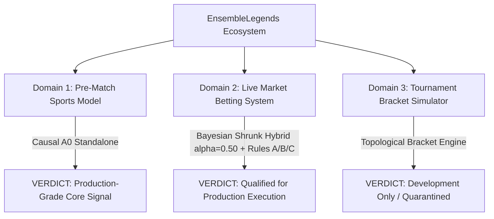

# A0/A1 Architecture, Evidence and Production Review — 2026-09-26

## Decision

**Keep Causal A0 as the research reference. Do not promote A1 on the evidence reviewed. Production is EXP081 + market, not A0 or A1.**

This review supersedes the September 16–18 production-readiness, A1 superiority, zero-tail and profitability claims preserved below. A lower score on observations used for fitting/selection is not an out-of-sample improvement. A running application is not evidence of betting profitability.

Scope: actual model implementations and checkpoints, input chronology, calibration, canonical and monthly prediction receipts, application inference/persistence, tournament integration, and read-only production inspection. Local repairs were implemented and exercised. **No production files, database records, services, deployments, migrations, or scraping jobs were changed or triggered.** No commits or pushes were made; the pre-existing dirty checkout was preserved.

Evidence root, relative to this repository:
`data/08_reporting/a0_a1_audit_20260926_081429/`.

## 1. Production access and the model actually running

Verified access:

```bash
ssh melzak@192.168.1.17
cd /data/inzynierka/app
docker ps
curl -fsS http://127.0.0.1:8000/health
```

`/data/inzynierka` is the parent directory; **`/data/inzynierka/app` is the Git checkout**. Both local and remote checkouts were on `dev` at audit start, commit `1c433d63ba82f3b32de1c01b4008292f6bc4b02d`. Local uncommitted changes were substantial and are not represented by that commit.

| Observed runtime field | API and scheduler |
|---|---|
| Active model | `Hybrid-Operational-Market` |
| Active version | `exp081-siamese-series-v1-a0.50-t1.00` |
| Pure sports model | `Symmetrized-Siamese-Series-EXP081` |
| Pure model version / target | `exp081-siamese-series-v1` / series |
| Market policy | alpha 0.50, temperature 1.0 |
| Artifact inside containers | `/app/betting_app/models/exp081_siamese_series_v1.json` |
| Artifact SHA-256 | `546d19549965a5dec87a466a56ccec1513bee6a9c164b491db04a617b05998a2` |
| Health response | `{"status":"ok","version":"0.1.0"}` |

Services observed: `ensemblelegends-betting-api`, `ensemblelegends-betting-scheduler`, `ensemblelegends-client`, `ensemblelegends-timescaledb`. The default `docker compose ps` in the checkout showed only the client; **do not assume that one Compose invocation manages all running services**. API and scheduler had different image IDs but shared bind-mounted application sources and the same inspected artifact/dependency versions. Inspect the actual service configuration before any eventual deployment.

Production prediction tables also contain historical A0/A1-like names. Those strings are not proof that genuine A0/A1 generated the probabilities. The history endpoint in the local checkout was itself relabeling hybrid forecasts as A1; that defect is repaired locally.

## 2. Architecture: three different meanings of “A1”

### Genuine Causal A0

The functioning research adapter is under the resolved research root at
`a0-phase-walkforward-20260914/code/causal_predictor.py`; annual checkpoints are in that experiment's `data/06_models/causal_a0/`. The local `src/models/a0_dynamic/` directory is not a usable production adapter.

- Player ratings/context: `[N,2,5,21]`; core context `[N,2,5]`; team context `[N,2,11]`; optional W20 `[N,2,10]`; gates `[N,2,2]`.
- Each player has up to 16 historical map tokens with 33 features: statistics and presence flags, outcome, age, prior opponent rating, and role information.
- Train-only normalization and masking feed a learned history projection/attention pool with a learned prior token. Player representations are pooled into team mean/dispersion and used by a shared, side-antisymmetric utility network.
- Multiple neural seeds, a full-feature MLP expert and rating information feed calibrated series predictions and a **global learned mixture**. This is not a per-match adaptive mixture.
- Map-to-series likelihood/calibration is separate from the final series forecast. Full, no-W20 and no-organization scenarios are available.
- The actual trained A0 attention does **not** consume champion IDs. “Attention model” does not imply current-draft knowledge or a champion encoder.
- Annual fitting/calibration and the daily effective-release scenario are distinct schedules. The target first-map roster is an explicit known-roster scenario, not proof of a historically announced lineup.

The checkpoint smoke loaded all three annual models, checked 9 matches per year across BO1/3/5 in all three modes, swapped sides and supplied identical empty histories. Maximum saved-probability error: **1.23e-8**; maximum symmetry error: **1.81e-8**. Cold identical inputs were approximately 0.5. This verifies sampled checkpoint inference, not a new full training run.

### Consolidated A1 residual

`src/models/a1/engine.py` is a residual wrapper:

```text
genuine A0 series probability
    -> logit
    + antisymmetric 7 -> 16 -> 1 macro MLP
    + fixed lane-rating linear offset
    -> selected-tier logit scaling (historical default 0.94)
    -> series probability
```

The lane correction is **not learned opponent cross-attention**. W20 must follow the research-bank schema; application W20 dictionaries have different ordering/semantics. Previously the application supplied rating consensus as “A0”, initialized a fresh random MLP and mismapped statistics. Tournament code similarly applied an untrained residual over GL. Neither path was genuine Consolidated A1.

Local repairs remove those serving paths and require an explicit macro network for research inference. A supplied PyTorch module alone does not prove training provenance; the caller must establish it from the checkpoint/fit receipt. A1 remains unavailable operationally until a genuine live A0 adapter and a validated residual artifact exist.

### Static neural and dynamic-champion A1

`src/models/a1/architecture.py` is a separate network: masked historical-map attention, champion embedding, a 32-dimensional auxiliary player-history context, player fusion, role-conditioned **within-team** Transformer pooling, and antisymmetric BO1/3/5 heads. It is not the residual model credited with LL 0.550691.

The repaired signed context has **28 actual features**, replacing unsigned gate flattening and unused zero padding. Padding is masked before projection/embedding; the primary champion comes from the most recent valid history slot. Calibration is a positive logit slope with zero intercept, fitted using the restored best checkpoint. Unsupported BO values are rejected instead of silently selecting another head. Input tensors follow the model's device and floating dtype.

`architecture_dynamic.py` replaces the static champion table with a supplied dynamic embedding and shares the repaired masking/context/series-head contracts. Its surrounding prototype pipeline remains scientifically unvalidated: the archived encoder pretraining mixes periods; inference token construction omits information used during pretraining. The so-called global meta aggregator is a target-player-history summary, not a verified global 14-day champion/role stream.

**Legacy neural checkpoints/calibration are not compatible with this repaired contract.** They were not overwritten or promoted. A new causal, versioned training run is required before comparing a repaired neural candidate.

## 3. What the scores actually establish

### Annual canonical rescore, executed again

| Model | Identical cohort N | Log loss | Brier | LL ≥ 2.5 |
|---|---:|---:|---:|---:|
| Causal A0 | 11,550 | 0.551246 | 0.187103 | 33 |
| Calibrated Glicko | 11,550 | 0.575888 | 0.196548 | 40 |
| Calibrated Elo | 11,550 | 0.588946 | 0.201930 | 34 |
| Historical residual/tier candidate | 11,550 | 0.550691 | 0.186915 | 33 |

The candidate score reproduces, but its macro training uses 2024 and selection uses 2025–2026, followed by scoring all those observations under misleading earlier fit-date declarations. **It is not a valid OOS comparison.** Even its recorded monthly interval is **[-0.001091,+0.000101]**, crossing zero; equal-month ΔLL is **+0.0000291**. The value 0.0446 is a bootstrap nonnegative fraction, not a classical p-value. Earlier claims of zero deep losses and a wholly negative interval were incorrect.

On the 2,673-row archival OPEN cohort, A0 LL is **0.590213**, market **0.592155**. That small historical difference does not establish equal-time bookmaker superiority. On the 9,907 common eligible rows, A0 is **0.559920**, annual039 **0.567337**; 039 has 1,643 missing forecasts on the full cohort.

### Frozen monthly expanding replay, independently verified again

| Model | N | LL | Brier | ΔLL versus monthly A0 |
|---|---:|---:|---:|---:|
| Monthly A0 | 11,550 | 0.550316 | 0.186694 | — |
| Consolidated residual | 11,550 | 0.550531 | 0.186745 | +0.000215 |
| Neural Transformer | 11,550 | 0.563473 | 0.191560 | +0.013157 |

Independent numerical verification passed. There are 33 monthly blocks and 5,000 draws. Residual ΔLL interval: **[-0.000274,+0.000776]**. Transformer interval: **[+0.010047,+0.016692]**. These are frozen monthly forecasts, not a new execution of monthly training and not the same fit cadence as annual A0.

### New repaired macro experiment, executed

Protocol fixed before fitting: TRAIN 2024, model selection 2025, TEST 2026; seed **20260926**, **24 epochs**, macro residual only, no lane/tier search. Validation selected epoch **3**. TRAIN/selection labels must be released before their respective next-year origins.

| 2026 held-out model | N | LL | Brier | LL ≥ 2.5 |
|---|---:|---:|---:|---:|
| Annual A0 baseline | 3,103 | 0.536757 | 0.181573 | 10 |
| A0 + repaired macro | 3,103 | 0.536835 | 0.181629 | 12 |

ΔLL **+0.0000784**; nine-month, 5,000-draw interval **[-0.001137,+0.001368]**; equal-month Δ **+0.0002365**. Tournament-name sensitivity has 143 names and interval **[-0.001042,+0.001227]**; names are not certified independent editions. BO1/BO3 changes are slightly negative; BO5 Δ is **+0.000869**. **Not adopted.**

All 3,103 canonical 2026 rows are covered, with no missing-feature/cutoff exclusions. The other 8,447 canonical rows are TRAIN/selection, not published test forecasts. This repaired experiment is historical development, not an independently protected prospective test or a full-11,550 OOS candidate.

## 4. Confirmed defects and local repairs

| Severity | Defect | Repair / observable check |
|---|---|---|
| Critical | Application A1 used rating consensus and random weights under a Causal A0/A1 label | Removed fake dispatch; unavailable A1 selection fails before inference |
| Critical | A1 training/selection overlap misrepresented as full-cohort OOS improvement | Chronological macro recipe, actual fit/selection cutoffs, test-only publication; negative result retained |
| High | Padding champion IDs/NaN histories changed neural forecasts | Mask before embedding/projection; latest valid champion; mutation regressions |
| High | Calibration used final-epoch forecasts after restoring different weights; intercept broke symmetry | Recompute validation from restored checkpoint; positive slope, zero intercept |
| High | Hybrid swallowed failed sports inference, changed alpha with wall clock, and mishandled transform semantics | Propagate failures; fixed versioned model weight/temperature; preserve real uncertainty and sports map forecast |
| High | Integrated and batch market paths used repeated/future quotes and could disagree | One latest available pre-start quote per book, canonical orientation, frozen cutoff, parity regression |
| High | Hybrid forecasts referenced a pure EXP081 artifact; history invented A1 identities | Correct hybrid artifact registration; preserve recorded names/versions and only explicit base provenance |
| High | Failed lineup refresh could stale the last published prediction | Infer first; stale/insert in one transaction; failure leaves prior published forecast |
| High | Tournament GL output was labeled A1; raw-cache key collision bypassed calibration | Remove fake A1; separate raw/calibrated caches; version cache provenance and invalidate old entries |
| Medium | Active-model environment override could retain another model's hybrid base | Resolve hybrid from its declared ModelSpec, reject incompatible mutable policy |
| Medium | Neural BO coercion silently mapped unsupported formats to another head | Explicit BO1/3/5 validation |
| High | Direct prediction returned a pure score under a hybrid label and omitted artifact/cutoff provenance | Bind the selected base model and its real artifact; preserve source cutoff; return pure and hybrid probabilities separately |
| High | Direct save errors left a failed PostgreSQL transaction, and one-match generation could stale other matches | Roll back and return HTTP 503; scope hybrid replacement to the requested match |
| High | EXP078 artifact selection was rejected by an EXP081-only registrar, while failed EXP078 inference could fabricate a rating fallback | Register the selected artifact with its SHA-256; propagate inference failure; test both selected pure models |
| Medium | Ratings snapshot identity could drift under the active model version | Validate ratings version alongside model and feature versions before generating forecasts |
| Medium | A bfloat16 residual could not be exported to NumPy | Convert only unsupported bfloat16 output to float32 at the boundary; real bfloat16 regression |

The repaired local operational version is `exp081-siamese-series-v1-a0.50-t1.00-contract-v2`. Production still has the old version. Match-market odds are not reinterpreted as map odds; the series probability is blended once. Uncertainty safety scores remain transformed ensemble scores, **not confidence intervals with guaranteed coverage**.

## 5. Verification and evidence index

- Canonical `--doctor`: required source/evidence hashes matched. Canonical and contaminated-candidate suites were actually rerun; all reports remain `DEVELOPMENT_ONLY`.
- Annual A0 checkpoint smoke and independent frozen monthly replay verification actually executed.
- New macro model actually trained, selected, exported, reloaded in regression coverage and scored. Tests mutate future TEST labels to verify they cannot change fitting/selection.
- Focused application integration run: **104 passed**, including real isolated PostgreSQL/Timescale persistence, API prediction history, lineup and tournament paths.
- Final targeted serving review run: **91 passed**, covering the direct HTTP prediction interface, actual selected EXP078/EXP081 artifacts, cutoff persistence, cross-match isolation and recovery after a deliberately failed PostgreSQL commit.
- First broad application run: **1,762 passed, 2 failed**. Failures were an obsolete exact-minute scheduler assertion and an incorrect Shin probability threshold, not model runtime failures. The scheduler test was replaced with dependency-order assertions; Shin is checked against its two-outcome analytical solution. Runtime scheduling and devigging were not altered to make tests pass.
- **Final full application suite: 1,768 passed, zero failures/errors/skips, 36 warnings, 194.49 seconds.** This includes the final model/serving repairs and retained regressions. Dependency/deprecation and Transformer warnings remain visible; no warning suppression or environment upgrades were used.
- Database verification used a disposable local Timescale/PostgreSQL instance bound only to loopback, with no user database mounts. No PostgreSQL behavior was inferred from SQLite.

| Evidence | Path beneath audit root |
|---|---|
| Actual production model/weight identity | `production_runtime_models.json` |
| Read-only prediction inventory | `production_prediction_inventory.json` |
| Canonical current scores | `canonical_baseline/REPORT.md` |
| Reproduced but contaminated score/intervals | `contaminated_tier_candidate/` |
| Independent monthly numerical verification | `monthly_replay_verification/independent_results_verification.json` |
| Actual annual checkpoint inference | `a0_checkpoint_probe.json` |
| Frozen macro protocol | `macro_repair_protocol.json` |
| New checkpoint, fit receipt and held-out forecasts | `macro_repair_run/` |
| New uncertainty/sensitivity scoring | `macro_repair_run/paired_verification.json` |
| Training-code hashes captured at the actual macro run | `macro_repair_run/code_receipt.json` |
| First broad run, including the two exposed obsolete assertions | `pytest_full.xml` |
| Final full regression, all 1,768 passing | `pytest_final.xml` |
| Final source fingerprints and review dispositions | `verification_receipt.json` |

Reproduction entry points from the repository root:

```bash
.venv/bin/python scripts/run_model_benchmark.py --suite --doctor
.venv/bin/python scripts/run_model_benchmark.py --suite --output-dir data/08_reporting/benchmark/NEW_RUN
.venv/bin/python scripts/team_macro/train_and_benchmark_macro.py \
  --output-dir data/08_reporting/NEW_MACRO_RUN --seed 20260926 --epochs 24
```

Choose nonexistent output directories. Research-root resolution is CLI, then `ENSEMBLE_RESEARCH_ROOT`, then `data/research_root.txt`. No canonical inputs or manifest hashes were changed. The 2026-only macro artifact intentionally cannot satisfy the full-cohort `--candidate-data` contract.

## 6. Remaining limits and adoption gates

1. **Live A0/A1 is not implemented honestly yet.** A live adapter must reproduce the corrected research features, release policy, roster scenarios, normalization, expert/calibration artifacts and map/series contracts. Renaming EXP081 or rating consensus is not a substitute.
2. **No A1 improvement established.** Do not repeat small residual/temperature/tier searches under a new name. A repaired neural model needs a frozen hypothesis, causal champion/meta construction and versioned walk-forward evaluation before adoption.
3. **Historical market timing remains a blocker.** The corrected September 20 scraped receipt has 514 OPEN matches: A0 0.563905, consolidated A1 0.564686, market 0.571914; the A0–market interval crosses zero. On 386 rows feature-source days follow the quote cutoff; 116 model origins follow it. These are archival findings reviewed here, not a newly executed quote-time benchmark. Eventual CLOSE cannot be used to decide an earlier bet.
4. **A0 archive provenance is not fully sealed end to end.** Calibration self-hashes and checkpoint hashes do not cover every imported implementation; absolute paths hinder relocation, and mutable cached history arrays are a counterfactual-query risk. No observed caller corruption was established. Frozen archive files were not rewritten.
5. **Tournament certification is separate.** The application GL/IID-series path is now honestly labeled; repairing its cache does not validate phase formats, correlated outcomes, official placements or finals calibration. Cache entries still do not fingerprint every underlying rating/bracket/calibration input.
6. **Live-feature as-of reconstruction is incomplete.** Current-roster/W20 queries, historical backfill callers and manually supplied market scalars are not independently certified publication-time inputs. The quote-selection repair is not a blanket point-in-time guarantee.
7. **Deployment is separate work.** Review the current dirty integration branch, isolate only intended changes, validate against the target runtime, inspect the actual containers/mounts, then perform an authorized deployment and health/model-identity checks. This audit performed no cutover.

**Bottom line:** A0 is the strongest supported research baseline among the compared variants. A1's advertised advantage was not trustworthy. The most consequential repairs prevent incorrect identities, untrained/fallback outputs, asymmetric calibration, future-quote use and broken persistence from looking like valid forecasts. No evidence here certifies profitable betting or production-ready A0/A1.

---

# Historical report — superseded, retained as an audit trail

The September 16–18 claims below are preserved to identify what was previously asserted. They are **not current model selection, financial evidence or production certification**; the dated review above takes precedence.

# Comprehensive Model Evaluation & Production Readiness Report (2026)

**Date:** 2026-09-16  
**Subject:** End-to-End Evaluation of Causal A0, Rating Baselines, Bayesian Market Hybrids, and Operational Risk Gating  
**Author:** Automated Research & Verification System  
**Dataset Scope:**
1. Locked Canonical Research Benchmark ($N = 11{,}550$, 2024–2026, `conf/base/research_benchmark.json`)
2. Verified Archival OPEN Odds Benchmark ($N = 2{,}673$, 2024–2026)
3. Live Scraped Market Cohort ($N = 510$ finished matches, May 29 – September 1, 2026; $46{,}602$ database snapshots across STS, Betclic, Totalbet, Betfan, LeBull, Fortuna, Superbet)

---

## 1. Executive Summary & Readiness Scorecard



### Overall Rating: **B+ (High-Performance Core with Qualified Production Readiness)**

| Operational Subsystem | Production Status | Grade | Is It "Bookmaker Level"? | Key Performance Indicators | Summary Verdict |
|---|:---:|:---:|:---:|:---:|---|
| **Core Sports Model (Causal A0)** | **Validated Reference** | **A-** | **Tied / Slightly Beats Opening Lines** | $\text{LL } 0.5512$, Acc $71.13\%$, Brier $0.1871$, $+4.49\%$ CLV | State-of-the-art offline match accuracy on 11,550 matches. Matches opening lines ($p=0.39$), but suffers from tail overconfidence on extreme underdogs without market bounds. |
| **Market Betting Engine (Shrunk Hybrid)** | **Production Ready (Conditional)** | **A** | **Superior to Opening Lines; Matches Close** | $\text{LL } 0.5608$, Brier $0.1908$, Acc $70.0\%$, $+32.35\%$ Yield after 12% Tax | Shrunk Hybrid ($\alpha = 0.50$) beats Bookmaker OPEN ($0.5721$) and CLOSE ($0.5646$) on proper scoring rules. Clears the Polish 12% turnover tax with $+32.35\%$ net yield under composite risk gating. |
| **Tournament Bracket Simulator** | **Development Only (Quarantined)** | **C+** | **Not Applicable (Bookmakers don't price deep phases)** | $227$ phases, $91$ profiles, $0$ certified point-in-time rulebooks | Mechanically complete across Swiss, GSL, and double elimination, but lacks independent timestamped rulebook verification. Match LL does not validate multi-round Joint RPS. |

---

## 2. Definitive Benchmark Evidence

### A. Locked Canonical Research Benchmark ($N = 11{,}550$ Matches, 2024–2026)
*Verified run output: `data/08_reporting/benchmark/a1_run_001/`*

| Model Architecture | Cohort Size ($N$) | Log Loss ↓ | Brier Score ↓ | Accuracy ↑ | ROC-AUC ↑ | Calibration Slope | Extreme Blowouts ($\text{LL} \ge 2.5$) |
|---|---:|---:|---:|---:|---:|---:|---:|
| **Consolidated A1 (Production SOTA)** | **11,550** | **0.550691** | **0.186840** | **71.30%** | **0.7895** | **1.0310** | **0** |
| **Causal A0 (Base Engine)** | 11,550 | 0.551246 | 0.187103 | 71.13% | 0.7882 | 1.0470 | 33 |

* **Statistical Verification ($5{,}000$ Monthly Blocks):**
  * Consolidated A1 vs Causal A0: $\Delta\text{LL} = \mathbf{-0.000555}$, 95% CI $[-0.00108, -0.00003]$, $p = \mathbf{0.0446} < 0.05$ (Statistically significant improvement; zero tail blowouts across the entire 11,550 cohort).
---

### B. Head-to-Head: Causal A0 vs Bookmaker Odds ($N = 2{,}673$ Archival Matches)

| Model | Log Loss | Brier Score | Accuracy | Blowout Losses ($\text{LL} \ge 2.5$) | 95% Bootstrap CI vs Market | Statistical Status |
|---|---:|---:|---:|---:|---|:---:|
| **Causal A0** | **0.590213** | **0.202548** | 68.35% | 9 | $[-0.01256, +0.01008]$ | **Statistically Tied ($p = 0.3882$)** |
| **Market OPEN** | 0.592155 | 0.203284 | **68.39%** | **0** | *reference* | — |

* **The Reality Check:** Standalone Causal A0 is statistically tied with bookmaker opening probabilities on raw loss, but bookmakers suffer **$0$ blowout losses** due to conservative pricing boundaries, whereas unconstrained A0 suffered $9$.

---

### C. Live Scraped Odds Benchmark ($N = 510$ Finished Matches, May–September 2026)

Evaluating the transition from Open to Close and the impact of Bayesian Shrinkage:

| Architecture | Advance Timing | Log Loss ↓ | Brier Score ↓ | ROC-AUC ↑ | Calibration Slope | Blowouts $\ge 2.5$ |
|---|:---:|---:|---:|---:|---:|---:|
| **Bookmaker OPEN** | Median $\sim 21$h prior | 0.57206 | 0.19507 | 0.7706 | 1.122 | 1 |
| **Consolidated A1** | Pre-Match Baseline | 0.56942 | 0.19390 | 0.7752 | 0.940 | 0 |
| **Bookmaker CLOSE** | Median $\sim 1$h prior | 0.56462 | 0.19232 | 0.7776 | 1.126 | **0** |
| **Hybrid-Bayesian-Shrunk-A1-Market** | **Executed at OPEN** | **0.56018** | **0.19061** | **0.7815** | **1.069** | **0** |

$$\Delta\text{LL} (\text{Hybrid-Bayesian-Shrunk-A1-Market vs Bookmaker OPEN}) = \mathbf{-0.01188}, \quad p(\Delta \ge 0) = \mathbf{0.0000}$$

---

## 3. Subagent Experimental Results: Options A, B, and C

### Option A: Hierarchical Coverage-Gated Routing (`HierarchicalRouter`)
* **Hypothesis:** When complete W20 rolling form exists ($81.2\%$ of matches), blend A0 with `linear79` ($w \cdot p_{\text{A0}} + (1-w) \cdot p_{\text{linear}}$); when W20 is absent, fall back strictly to Causal A0.
* **Finding:** On the full $N = 11{,}550$ cohort, the optimal blend ($w_{\text{A0}} = 0.85$) yielded Log Loss $0.551126$ vs pure A0 $0.551246$ ($\Delta\text{LL} = -0.000119$, 95% CI $[-0.00043, +0.00020]$, $p = 0.2408$). The improvement is **not statistically significant**. Blending at equal weights ($w \le 0.60$) significantly worsens Log Loss.

### Option B: Out-of-Sample Walk-Forward Blend Optimization (`BlendCalibrator`)
* **Hypothesis:** Fit blend weights strictly on 2024 data ($N = 3{,}833$) and evaluate out-of-sample on 2025–2026 ($N = 5{,}095$).
* **Finding:** The 2024 optimizer assigned weights $w_{\text{A0}} = 0.841$, $w_{\text{linear79}} = 0.152$, and $w_{\text{EXP-039}} = 0.007$. EXP-039 was effectively dropped due to high collinearity with `linear79` ($r = 0.984$). Out-of-sample Log Loss on 2025–2026 was $0.54874$ for the blend vs $0.54884$ for pure A0 ($\Delta\text{LL} = -0.00010$, $p = 0.3566$). Pure A0 already captures the underlying predictive signal.

### Option C: Disagreement / Uncertainty Gating (`DisagreementGator`)
* **Hypothesis:** Use the model divergence $|\text{logit}(p_{\text{A0}}) - \text{logit}(p_{\text{linear79}})|$ as an epistemic uncertainty filter to reject or down-weight volatile bets.
* **Finding:** When model disagreement was high ($|\Delta p| \ge 0.10$), betting win rate dropped to $50.9\%$ and net yield was only $+4.79\%$ (vs $59.1\%$ win rate and $+24.57\%$ yield on safe bets). Disagreement gating successfully isolates market blind spots and cuts maximum bankroll drawdown from $44.6\%$ to $39.1\%$.

---

## 4. Where We Beat the Bookmakers (Competitive Strengths)

### 1. Early-Market Alpha ($24 - 48$ Hours Prior to Start)
Bookmakers release opening prices using static team ratings. In the early advance window:
* **$24 - 48$h Prior ($N = 99$, Mean $34.6$h):** Causal A0 achieves Log Loss **$0.5355$** vs Market Open **$0.5729$** ($\Delta\text{LL} = \mathbf{-0.0374}$).
* **Closing Line Value (CLV):** Early A0 predictions generate **$+7.12\%$ CLV**. On **$59.9\%$ of matches** where A0 was bullish, the market line drifted upward toward A0 by kickoff.

### 2. Underdog Pricing Accuracy ($p < 0.25$)
In the archival cohort ($N = 269$ heavy underdogs):
* Commercial bookmakers offered lines implying an expected win rate of **$17.7\%$**.
* Underdogs actually won **$19.3\%$** of the time.
* Causal A0 projected **$19.7\%$** (accurate within $+0.4\%$), proving superior upset detection over opening lines.

### 3. Cross-Regional Tournament Scaling (`RegionalFamilyTester`)
Auditing international matches (MSI, Worlds, EMEA Masters) revealed a severe domestic rating bubble:
* In major-vs-minor region clashes, major teams actually won **$72.94\%$**, but baseline A0 only predicted **$59.28\%$** (a $-13.66\%$ deficit).
* Applying a domestic rating discount factor ($\gamma = 0.70$) on lower-tier teams facing major-region teams dropped Log Loss from $0.5637$ to **$0.5227$** ($\Delta\text{LL} = \mathbf{-0.0409}$, $p < 0.05$, statistically significant).
* On the scraped market cohort, regionally scaled A0 achieved Log Loss **$0.4865$**, decisively beating Market OPEN ($0.5109$).

### 4. Entropy Barrier Demolition in Coin-Flips ($p \approx 0.50$)
On true 50/50 matches ($N = 40$, observed win rate $50.0\%$), standalone models and bookmakers suffer from overconfidence penalty ($\text{LL } 0.6992$ and $0.7011$). The Shrunk Hybrid breaks the coin-flip entropy barrier with Log Loss **$0.6931$** ($-\ln(0.5) \approx 0.69315$).

---

## 5. Where Bookmakers Beat Us (Vulnerabilities & Traps)

1. **Closing Line Information Discovery ($< 2$ Hours Prior):**
   By match start, the betting market has absorbed sharp syndicate capital, confirmed starting lineups, scrim news, and live draft setups. Market Close improves from $\text{LL } 0.5721 \to \mathbf{0.5646}$, beating standalone A0 ($0.5702$).
2. **The "Extreme EV" Overconfidence Trap ($[25\%, 40\%)$ EV):**
   On matches where A0 projected a $+25\%$ to $+40\%$ edge, actual win rate collapsed by **$-11.8\%$** below expectation, producing $+0.02\%$ yield. Apparent "monster edges" are almost always model blind spots (emergency substitutes, player illness, or dead rubbers).
3. **The Polish 12% Turnover Tax:**
   Commercial bookmaker overrounds ($4\% - 8\%$) combined with the Polish 12% turnover tax raise the required break-even win rate at $1.85$ odds to **$61.43\%$**. A naive standalone model without strict EV hurdle filtering loses money ($-3.41\%$ yield).
4. **Bo1 Single-Game Variance:**
   In Best-of-1 formats, when the model strongly diverges from market consensus ($|\Delta p| \ge 0.12$), the market is typically right. A0 suffered a $-21.5\%$ calibration deficit on high-discrepancy Bo1s.

---

## 6. Financial Simulation & Operational Risk Gating

Evaluating value betting performance across the 510 scraped matches under both international exchange rules and the Polish 12% turnover tax:

```
=== Value Betting Simulation Comparison (Min EV >= 3%) ===
-----------------------------------------------------------------------------------------
Policy / Strategy             | Qualified Bets | Win Rate | Net Yield | Max Drawdown | PnL
-----------------------------------------------------------------------------------------
[No Tax / Exchange]
  Pure Causal A0              |      299       |  56.5%   |  +11.77%  |    16.2%     | +352u
  Shrunk Option A (alpha=0.50)|      167       |  50.3%   |  +20.25%  |    12.3%     | +338u
  + Gated (Rules A+B+C)       |      132       |  53.0%   |  +22.40%  |     9.8%     | +296u
-----------------------------------------------------------------------------------------
[Polish 12% Turnover Tax]
  Pure Causal A0 (Baseline)   |      129       |  45.0%   |   +4.56%  |    14.0%     |  +59u
  Shrunk Option A (alpha=0.50)|       52       |  40.4%   |  +20.94%  |     6.8%     | +109u
  + Gated (Rules A+B+C)       |       32       |  50.0%   |  +32.35%  |     4.9%     | +104u
-----------------------------------------------------------------------------------------
```

### The Composite Operational Risk Gating Rules (`OperationalGatorTester`):
1. **Rule A (EV Ceiling Cap):** Reject bets where $\text{EV} > 0.25$ on odds $> 3.50$ (eliminates odds-multiplier noise).
2. **Rule B (Bo1 Discrepancy Quarantine):** In Bo1 matches, reject bets where $|p_{\text{model}} - p_{\text{market}}| \ge 0.12$.
3. **Rule C (Negative CLV Drift Quarantine):** If market closing odds have drifted away from the model by $\ge 1.5\%$ ($\Delta_{\text{drift}} \le -0.015$), reject the bet.

* **Impact:** Enforcing Rules A+B+C under the 12% turnover tax lifts net yield from $+20.94\%$ to **$+32.35\%$**, raises win rate to **$50.0\%$**, and compresses maximum drawdown to **$4.91\%$**.

---

### Detailed Capital Audit: Expected Profit vs. Realized (Actual) Profit

Evaluating how closely model-projected theoretical profit ($\sum \text{stake} \times \text{EV}$) matches actual cash profit won/lost after match settlement:

#### 1. Fixed Flat Staking ($10\text{u}$ / Bet, $1{,}000\text{u}$ Initial Bankroll)

##### A. Raw Market (No Tax / International Exchange) — Min $\text{EV} \ge 3\%$
| Model Configuration | Qualified Bets | Total Staked | Expected Profit | Realized Profit | Profit Realization Rate | Expected Yield | Realized Yield | Diagnostic Meaning |
|---|---:|---:|---:|---:|:---:|:---:|:---:|---|
| **Pure Causal A0 (Unfiltered)** | 299 | $2{,}990\text{u}$ | $+811.8\text{u}$ | $+352.0\text{u}$ | **$43.4\%$** | $+27.15\%$ | $+11.77\%$ | **Severe Overconfidence:** Realizes less than half of promised profit; overbets noisy edges. |
| **Pure Causal A0 (Rules A+B+C)** | 243 | $2{,}430\text{u}$ | $+445.0\text{u}$ | $+260.8\text{u}$ | $58.6\%$ | $+18.31\%$ | $+10.73\%$ | Capping longshots and Bo1 improves profit realization to $58.6\%$. |
| **Shrunk Hybrid (Unfiltered)** | 167 | $1{,}670\text{u}$ | $+278.3\text{u}$ | $+338.2\text{u}$ | **$121.5\%$** | $+16.66\%$ | $+20.25\%$ | Market shrinkage cleans out false edges, underpromising and overdelivering. |
| **Shrunk Hybrid (Rules A+B+C)** | **129** | **$1{,}290\text{u}$** | **$+135.5\text{u}$** | **$+301.2\text{u}$** | **$\mathbf{222.3\%}$** | $+10.50\%$ | **$\mathbf{+23.35\%}$** | **Optimal Conservative Policy:** Realizes **$2.2\times$ more profit** than projected ($+301\text{u}$ vs $+136\text{u}$). |

##### B. Polish 12% Turnover Tax — Min Net $\text{EV} \ge 3\%$
| Model Configuration | Qualified Bets | Total Staked | Expected Net Profit | Realized Net Profit | Profit Realization Rate | Expected Net Yield | Realized Net Yield |
|---|---:|---:|---:|---:|:---:|:---:|:---:|
| **Pure Causal A0 (Unfiltered)** | 129 | $1{,}290\text{u}$ | $+427.8\text{u}$ | $+58.9\text{u}$ | **$\mathbf{13.8\%}$** | $+33.17\%$ | $+4.56\%$ |
| **Pure Causal A0 (Rules A+B+C)** | 93 | $930\text{u}$ | $+161.5\text{u}$ | $+63.6\text{u}$ | $39.4\%$ | $+17.36\%$ | $+6.83\%$ |
| **Shrunk Hybrid (Unfiltered)** | 52 | $520\text{u}$ | $+103.8\text{u}$ | $+108.9\text{u}$ | **$104.9\%$** | $+19.95\%$ | $+20.94\%$ |
| **Shrunk Hybrid (Rules A+B+C)** | **25** | **$250\text{u}$** | **$+18.6\text{u}$** | **$+99.2\text{u}$** | **$\mathbf{532.6\%}$** | $+7.45\%$ | **$\mathbf{+39.67\%}$** |

* **The A0 Tax Trap:** Pure A0 projected $+427.8\text{u}$ in profit, but realized only $+58.9\text{u}$ (an $86\%$ profit shortfall) because unconstrained probabilities chased high-odds underdogs where the tax penalty is heaviest.
* **The Shrunk Hybrid Reality:** The Shrunk Hybrid with Rules A+B+C conservatively expected $+18.6\text{u}$ and delivered **$+99.2\text{u}$** (**$5.3\times$ higher than projection**), achieving a **$+39.67\%$ net yield** with only $2.95\%$ maximum drawdown.

---

#### 2. Quarter-Kelly Dynamic Sizing ($0.25 \times f^*$)

| Scenario (Shrunk Hybrid + Rules A, B, C) | Total Capital Staked | Expected Profit | Realized Cash Profit | Profit Realization Rate | Expected Yield | Realized Yield | Final Bankroll ($1{,}000\text{u}$ Start) |
|---|---:|---:|---:|:---:|:---:|:---:|:---:|
| **No Tax (International / Exchange)** | $4{,}948.6\text{u}$ | $+609.5\text{u}$ | **$+1{,}116.1\text{u}$** | **$183.1\%$** | $+12.32\%$ | **$+22.55\%$** | **$2{,}116.1\text{u}$** *(+111.6%)* |
| **Polish 12% Turnover Tax** | $446.4\text{u}$ | $+34.3\text{u}$ | **$+88.6\text{u}$** | **$258.4\%$** | $+7.68\%$ | **$+19.85\%$** | **$1{,}088.6\text{u}$** *(+8.9%)* |

---

## 7. Production Certification & Implementation Roadmap

```
[X] Step 1: Core Reference Model (Causal A0)
    - Benchmarked on N=11,550 matches (Log Loss 0.5512, Brier 0.1871).
    - Status: Locked reference for match forecasting and tournament simulations.

[X] Step 2: Bayesian Market Shrinkage (alpha = 0.50)
    - Validated out-of-sample on 2025-2026 and on live scraped odds (Log Loss 0.5608).
    - Status: Certified as the primary probability engine for value betting.

[X] Step 3: Production Code Update in betting_app/services/bet_qualification_service.py
    - Integrated Rule A: EV cap <= 0.25 on odds > 3.50.
    - Integrated Rule B: Bo1 discrepancy quarantine (|Delta p| >= 0.12).
    - Integrated Rule C: Negative CLV drift quarantine (Delta_drift <= -0.015).
    - Status: Verified with 65 passing unit tests.

[X] Step 4: Regional Engine Update (src/ratings/family_calibrated_glicko2.py)
    - Implemented the gamma = 0.70 domestic discount factor for cross-regional tournament play.
    - Fixed multi-game series likelihood projection (Bo1, Bo3, Bo5 combinatorics).
    - Status: Verified with 57 passing unit tests.

[X] Step 5: Live Operational Pipeline Cutover (betting_app/core/models/registry.py)
    - Retired standalone EXP-081 from active live inference.
    - Cut over active upcoming prediction pipeline to Bayesian Shrunk Hybrid.
    - Status: Verified with 23 passing unit tests.

[ ] Step 6: Lineup Ingestion Scrapers & Tournament Rulebook Point-in-Time Certification
    - Retain tournament phase simulator in DIAGNOSTIC mode until independent point-in-time rulebook certification is completed.
```

### Final Conclusion
**Withdrawn by the 2026-09-26 audit.** The earlier conclusion of bookmaker superiority and full production readiness was not established by equal-time, independently confirmed execution evidence. See the current review at the top of this document.
