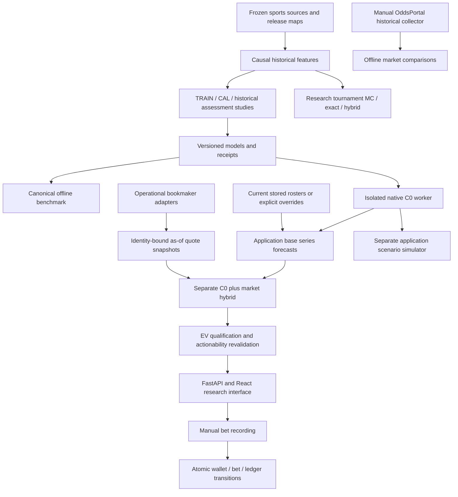

# EnsembleLegends — project deep research

**Research date:** 2026-10-09. **Scope:** current local worktree, retained research artifacts, primary literature, and bounded offline runtime probes. **Decision:** preserve existing scientific decisions; no model fitting, sports/odds acquisition, source activation, database migration, remote inspection, or deployment.

Evidence: [execution receipt](../data/08_reporting/project_deep_research/project_deep_research_20261009_01/execution_receipt.json), [source/access ledger](../data/08_reporting/project_deep_research/project_deep_research_20261009_01/external_sources.json), and [six-track findings](../data/08_reporting/project_deep_research/project_deep_research_20261009_01/tracks/).

## 1. Executive conclusion

**EnsembleLegends is an implemented research-and-application system, not an established bookmaker-beating or tournament-calibrated forecasting product.** Its strongest assets are explicit model identities, causal replay contracts, complete-cohort scoring, preserved negative experiments, bounded native inference, and increasingly explicit probability-law and financial-state invariants. Its principal unresolved objectives are authentic decision-time information, independent predictive confirmation, tournament-edition evidence, and selected-bet reliability.

The appropriate working choice remains **unchanged native C0 for series winners**, **annual Causal A0 as the canonical historical control**, and the **separate standalone prop bundle** for Map 1 kills/duration and series length. This is the existing shortlist, not a new promotion. Local C0 is neither annual A0 nor the EXP081 identity observed on an older remote server. A current local native-worker probe verified the configured C0 artifact; today's remote serving state was not inspected.

| Area | Established evidence | Boundary that remains |
|---|---|---|
| Winner models | Canonical A0 beats player-rating controls on the complete retained cohort; native C0 is the retained local winner reference | No established current bookmaker superiority, practical equivalence, or untouched-future confirmation |
| Local inference | Real C0 worker accepts explicit BO1/3/5 requests, exposes identity/input hashes, and remains approximately neutral for unseen players | Frozen history ends 2026-09-08; a new decision timestamp is not a live data refresh |
| Props | Simple kill baseline; duration and length development candidates; restored prepared-input inference replays exactly | Duration interval undercoverage, negative historical length-market evidence, no live feature adapter or joint/parlay law |
| Tournament integration | Exact/hybrid research integration and explicit numerical uncertainty exist; small rational oracle passes | Application formats remain scenario implementations; dependence challengers failed; authenticated edition-level predictive quality is unestablished |
| Betting application | Quote admission, one-time hybrid composition, recommendation revalidation, and manual wallet transitions are implemented | Correct mechanics do not authenticate historical execution or establish calibrated selected EV/profit |
| Operations | Explicit source gates, model/source pins, Caddy protection, disposable smoke configuration, and a prop recovery bundle | Python environment is not completely locked; off-machine recovery and current deployment state are not established |

**Priority recommendation:** separate evidence work from model development. Authentic sources and a prospective ledger are prerequisites for live/financial claims; they do not imply that all historical modeling must stop. Conversely, another historical architectural sweep cannot repair missing issuance evidence. The root cause of the remaining predictive gap is not identified by this research.

## 2. Methodology, scope, and evidence strength

Six parallel tracks examined: (1) model/data evidence; (2) tournament rules and integration; (3) inference, quotes, and financial services; (4) collection, frontend, and deployment; (5) forecasting literature; and (6) operational standards and trust boundaries. Four scouts performed read-only repository investigation; two researchers read external primary papers and official documentation. The parent inspected high-materiality code/configuration and executed the runtime probes below after that research wave.

The investigation began on `dev`, two commits behind the observed `origin/dev`, with 137 staged, 164 unstaged, and 328 untracked entries. These were treated as the user's work. This report describes the **observed worktree**, not a clean commit, a reviewed PR, or a deployed release. No reset, cleanup, commit, push, or server mutation occurred. No language server was configured; navigation used repository structure and targeted reads.

Twenty-seven external source records were retained. Twenty-five full-text/manuscript or official-documentation records support the bibliography. Two weaker-access records—Gilleland's bootstrap article and the retrieved Diebold–Mariano copy—were excluded from substantive citations rather than promoted from snippets. Vendor practitioner reports are labeled as such; their published numbers are not project benchmarks.

Evidence is kept in four categories:

- **Freshly exercised:** the canonical scoring CLI, native C0 cold inference, an independent rational tournament oracle, prop-bundle restoration, and safe ASGI routes.
- **Existing measured evidence:** frozen decisions, saved probabilities, completed research reports, and prior software/database receipts. These were inspected, not rerun as new studies.
- **Code-supported contracts:** specific validation, transaction, routing, and configuration behavior. Static tracing is not comprehensive runtime certification.
- **Recommendations / [INFERENCE]:** proposed priorities and possible consequences. These are not observed defects, causal explanations, or authorization to start new experiments.

High-materiality conclusions combine different evidence types: local model identity uses configuration, loader/registry code, and actual worker output; the frozen-history boundary uses loader provenance and runtime diagnostics; tournament integration uses source contracts, retained studies, and an independent oracle. Literature supports the inferential distinctions, not the truth of the project's source data.

This was not a full security audit, dependency vulnerability scan, GPU/image build, browser regression, PostgreSQL migration exercise, throughput study, new model experiment, or independent replay of every historical verification assertion. No user-configured database or collection job was exercised. External web access was limited to research papers/documentation; no new sports or odds dataset was collected.

## 3. Architecture: separate systems with explicit bridges

The repository combines an offline scientific workflow and an operational application. They share some modules and input conventions but do not share one universal execution engine or one universal meaning of “the model.”



The manual bet path records bets; it does not automatically place them with bookmakers. The OddsPortal historical collector is separate from scheduled application bookmakers. Research exact/hybrid integration is separate from the application's Monte Carlo scenario services. These boundaries are essential when attributing a result to a model or claiming that a feature is operational.

### Navigation and ownership

| Question | Start here | Contract to preserve |
|---|---|---|
| Which model/study should be used? | [Model catalog](../docs/MODEL_CATALOG.md), [research journal](../docs/RESEARCH.md) | Retained candidates, completed negatives, explicit cohorts and limitations |
| How is accuracy scored? | [Benchmark CLI](../scripts/run_model_benchmark.py), [suite implementation](../src/analysis/research_benchmark.py), [manifest](../conf/base/research_benchmark.json) | One benchmark, pinned inputs, full coverage/missingness, matched orientation |
| What does local serving load? | [C0 config](../conf/base/c0_serving.json), [native loader](../betting_app/core/models/native_c0.py), [registry](../betting_app/core/models/registry.py) | Original control identity, pinned bytes, declared forward status |
| How does API inference reach native archives? | [C0 process client](../betting_app/services/c0_inference.py), [worker](../betting_app/services/c0_worker.py) | Bounded JSON-lines protocol; no archive namespace in the API process |
| How are fixtures/rosters validated? | [Upcoming inference](../betting_app/services/upcoming_inference_service.py), [current rosters](../betting_app/services/current_roster_service.py) | Exact participants, five IDs per side, clocks, context, persistence revalidation |
| Which odds are actionable? | [Prematch quotes](../betting_app/services/prematch_quote_service.py), [qualification](../betting_app/services/bet_qualification_service.py) | Latest state, freshness, start/identity/lineage gates; unavailable remains unavailable |
| What defines research financial policy? | [Unified evaluation engine](../src/analysis/unified_evaluation_engine.py) | Do not substitute the research policy for the actual application selection |
| How do manual funds move? | [Wallet service](../betting_app/services/wallet_service.py), [bet routes](../betting_app/api/routers/bets.py) | Decimal normalization, conditional debit, one-success settlement, shared commit |
| Where are tournament laws implemented? | [Research formats](../src/models/tournament_formats.py), [exact integration](../src/models/tournament_exact.py), [app service](../betting_app/services/tournament_service.py) | Named formats, series probabilities, explicit unsupported cases, scenario provenance |
| Where are collection/deployment boundaries? | [Scheduler registry](../betting_app/scheduler/registry.py), [source matrix](../conf/base/a0_context_reliability_sources.json), [Compose smoke overlay](../docker-compose.smoke.yml) | No implicit activation; no regular database volume in disposable checks |

The existing [architecture guide](../docs/PROJECT_ARCHITECTURE.md) and [script index](../scripts/README.md) already provide navigation. A second benchmark framework, a second schema initializer, or a blanket service rewrite would add competing conventions without addressing the identified evidence gaps.

## 4. Data lineage and information availability

### 4.1 Populations must not be silently interchanged

The frozen GOL.GG source contains **41,915 series / 69,370 maps**. The corrected feature bank has **40,636 target rows**. The canonical annual winner benchmark contains **11,550 series in 2024–2026**. Many recent native/prop studies assess **3,103 canonical 2026 series**, while the latest Polish bookmaker comparison admits **1,467** and the standalone length task scores **2,358 BO3/5 series**.

These are different populations, not successive estimates of one number. An annual A0 full-cohort loss cannot be compared directly with native C0's 2026 loss or a market-linked subset. A missing prediction is a coverage limitation, not zero loss. The canonical runner enforces complete candidate coverage and orientation rather than letting a challenger choose a convenient intersection.

### 4.2 Temporal meaning is part of the model contract

For actual forecast issuance the required relation is:

`source/release time <= data_cutoff_at <= predicted_at < target_start_at`

Historical daily scenarios use strictly earlier effective releases, but daily fences do not independently prove publisher release, announcement, or user-visible issuance. A game's play date, a provider's change timestamp, local response receipt, first observation, and database recording time answer different questions. W3C provenance describes entities, activities, and agents; its observation vocabulary supplies semantic distinctions, not authentication of this project's timestamps. [13,14]

The capture/opportunity schemas already separate several clocks; see the [Plan09 migration](../betting_app/alembic/versions/d4e5f6a7b8c9_plan09_capture_and_opportunity_ledger.py). This is a good foundation. The remaining requirement is trustworthy producer-specific meaning and binding, not another column called `timestamp`.

Current roster loading requires exactly five role slots and records source/match/game/update provenance. Upcoming inference records that this is unauthenticated current-state information, with publication/observation unknown. Complete identity is therefore not proof of an officially announced starting lineup. Operator overrides are separate assumptions, not source authentication. Roster retractions and competition-context distinctions remain important: “same organization two days ago” can still be a different competition squad.

### 4.3 Fresh decision clock, frozen sports history

[Serving configuration](../conf/base/c0_serving.json) selects the canonical frozen history and original control artifacts. In this investigation, a real native request used an October 9 decision date. The worker reported source-game, effective-release, and feature-history maxima of **September 8**. It correctly disclosed `frozen_static_2026_artifact_not_prospective_certified`.

**Confirmed boundary:** operationally recent rosters or quotes do not refresh the frozen player-history source. **[INFERENCE]:** deploying this unchanged path as a current-form forecaster would omit intervening sports evidence. The magnitude and direction of predictive harm were not measured. A safe future adapter requires separately versioned, release-aware inputs and unchanged causal/identity invariants; it is not solved by backdating predictions or silently replacing pinned source bytes.

### 4.4 Archive scale is not archive completeness

The retained OddsPortal execution reports **18,147 attempted events, 18,004 usable moneylines, 143 failures, 41 leagues, 177 seasons, and 428 advertised pages**. The [inventory audit](../data/08_reporting/oddsportal/oddsportal_full_20261007_114857Z/inventory-v2-audit.json) simultaneously records 149 completed seasons, 27 source-absent seasons, one failed Sea Tour locator, and `inventory_complete:false`. These statements are compatible: every advertised page in the collected inventory was visited, but publisher-level coverage is not complete.

Provider “open” and “last change” fields are not certified market opening and terminal closing quotes. The retained quote verification identifies 506 open and 828 last-change timestamps at/after source event start. [Collection code](../src/utils/oddsportal_collection.py) explicitly names the timing `provider_open_and_last_not_certified_close`. These fields must not become certified CLOSE/CLV or executable odds merely through downstream labels.

Exact response bytes, strict participant/event parsing, bounded requests, denial handling, and explicit absences are useful integrity controls. They neither grant access/retention rights nor establish source truth. The archived manual acquisition is also not evidence that the forward collection contract has been activated.

## 5. Models: what is retained and what the experiments actually show

### 5.1 Native C0 is a specific frozen recipe

The local identity is `Causal-C0`, version `c0-native-2026-w32-e12-v1`, feature version `native-c0-history16-v1`, from `a0_data_focus_20260929_192443/control`. It is the original width-32/12-epoch control, with three history-network seeds plus shared rating/MLP experts and calibration/assembly. Selecting it from configuration and receipts is safer than choosing a folder by recency or a model by its name.

The native representation already includes player ratings, support/experience/inactivity, coplay, optional organization/W20 context, and attention over up to 16 released maps per player. Historical statistics, roles, ages, opponent information, masks, and champion identities are already represented in the native input contract. “Add player form,” “add a graph,” or “add regional information” is not automatically a new hypothesis.

C0 returns **whole-series winner probabilities for BO1/3/5**. It does not return a map probability or measured epistemic bound. The public application adapter rejects invented uncertainty and avoids a second BO projection. Modes `full`, `no_w20`, and `no_organization` are same-artifact inference contracts, not newly retrained causal ablations. New/national rosters may work without organization history; their predictive reliability is still an empirical question.

The separate JSON-lines worker solves a real archive-import/namespace boundary. Its configured startup/request limits are 600/300 seconds, with request/lifetime recycling bounds and a 16 MiB frame cap. The client serializes access with a lock. This is bounded process management, **not** a hostile-code sandbox or a demonstrated concurrency/latency SLO.

### 5.2 Fresh canonical rescore

The existing doctor validated all five pinned input/evidence digests. The existing suite then rescored stored forecasts; it did not train or regenerate walk-forward probabilities.

| Canonical population | Forecaster | N | Log loss | Brier | LL >= 2.5 losses |
|---|---|---:|---:|---:|---:|
| All 2024–2026 | Annual A0 | 11,550 | 0.551246 | 0.187103 | 33 |
| All 2024–2026 | Calibrated Glicko | 11,550 | 0.575888 | 0.196548 | 40 |
| All 2024–2026 | Calibrated Elo | 11,550 | 0.588946 | 0.201930 | 34 |
| 039 common support | Annual A0 | 9,907 | 0.559920 | 0.190439 | 30 |
| 039 common support | Annual039 derivative | 9,907 | 0.567337 | 0.193112 | 16 |

The derivative has 1,643 missing forecasts on the complete cohort. Frozen EXP-039 is a different artifact. A0 improves average loss on common support; the derivative has fewer deep losses. Neither isolated observation chooses a production system. The new [canonical report](../data/08_reporting/project_deep_research/project_deep_research_20261009_01/canonical_benchmark/REPORT.md) remains `DEVELOPMENT_ONLY`.

Strictly proper scores reward honest predictive distributions in expectation. Gneiting and Raftery's direct comparability condition is exact: “Scores for competing forecast procedures are directly comparable if they refer to exactly the same set of forecast situations.” [1] This supports preserving full cohorts and separate targets, not claiming that one lower historical average certifies every downstream use.

### 5.3 Completed negative experiments are reusable evidence

| Study family | What was actually tested | Current conclusion to retain |
|---|---|---|
| Fresh architectures / ground-up models | Raw logistic/tree/role network, input fusion, separate encoders, specialist connector | None replaced annual A0; repaired cold-start outputs and old replay caveats remain separately recorded |
| Native refit and data focus | Annual/monthly × uniform/H365; tier/market weighting and token dropout | H365 rejected; monthly-uniform inconclusive; focus/dropout not adopted; the uniform data-focus control is retained C0 |
| Reconstruction and native6+12 | Temporary statistics reconstruction and matched updates; subsequent earlier-origin replication | Reconstruction rejected; the initially favorable secondary mixture signal failed replication |
| Capacity / distillation | Width16/32/64, 12/24 endpoints, paired seeds | Capacity not adopted; distillation skipped by its frozen evaluation gate, not unsuccessfully trained |
| Sports connectors | Multiple separately frozen correction recipes, including a matched C0-only control | Connector03 is a historical development candidate, not established above C0; Plan09 fails replacement guards |
| Champion/meta representations | Champion summaries, 30-day role/meta, 180-day support follow-up, historical-champion multitask network | Not adopted; stable follow-up selects zero amplitudes; no universal representation-uselessness conclusion |
| Competition-family bridge | Matched player versus family bridge, then separate A0 integration | Standalone component improves its rating control; calibration tolerance unresolved; A0 integration fails |
| Context calibration | Detect residual persistence then conditionally fit | Persistence not confirmed; conditional branch not run, not a failed fitted conditional predictor |
| Tournament uncertainty | Residual/score-law challenger and later marginal-preserving copula | Not adopted; numerical fixes retained; no tournament-quality promotion |

The [catalog](../docs/MODEL_CATALOG.md) and [journal](../docs/RESEARCH.md) bind detailed results. They distinguish a failed predictive recipe, a skipped branch, an integrity repair, and a favorable component that failed integration. Repeating any of these as “untested” would waste evidence and introduce additional adaptive selection.

Cawley and Talbot emphasize treating model selection as part of fitting, not as a harmless operation outside evaluation. [4] An earlier/later split can preserve chronology while repeated inspection of its assessment year still makes that year development data. Existing monthly confidence intervals and local Bonferroni families do not adjust all adaptive historical research.

### 5.4 Champion-history nuance

The latest historical-champion study is not a target-draft forecast. It compares hidden/included historical champions under score-only/multitask training, with matched controls. CAL-selected winner D has LL **0.546320524**, versus unchanged C0 **0.535448701** on the same 3,103 series. Its duration head improves the old standalone duration reference, but does not establish champion value against the matched hidden-champion control. The bundle remains **NOT_ADOPTED for all tasks**.

TRAIN has no unknown-token examples for several embedding categories while assessment contains many unknown tokens. This is a concrete representation limitation, **not an established causal explanation** for the result. No automatic OOV repair or larger-network retry follows from identifying it. The separate actual-composition oracle also failed its information gate; its deferred draft-policy branch must not be described as completed.

## 6. Bookmaker competitiveness and probabilistic reliability

### 6.1 Latest matched comparison, not the older archival OPEN cohort

[Plan12's completed comparison](model_bookmaker_competitiveness_execution_20261009.md) uses the same 1,467 admitted 2026 series for all four forecasters:

| Forecaster | Log loss | Brier | Model-minus-consensus LL | Nominal 95% LL interval | Adjusted family LL interval |
|---|---:|---:|---:|---|---|
| Polish consensus | 0.559604853 | 0.189266950 | — | — | — |
| Native C0 | 0.565904908 | 0.192123748 | +0.006300054 | [-0.007429, +0.020895] | [-0.012585, +0.027929] |
| Corrected thesis LR | 0.570802361 | 0.193908558 | +0.011197508 | [-0.005247, +0.027307] | [-0.012643, +0.037644] |
| Thesis MLP8 | 0.573508843 | 0.195254691 | +0.013903990 | [-0.002183, +0.030676] | [-0.008338, +0.040705] |

Consensus is best on point scores; C0 is the closest tested model. All six primary nominal pairwise LL intervals and all twelve adjusted primary/fixed-four intervals cross zero. This establishes neither a unique population winner nor equality. All three observed model-versus-market Brier nonincrease guards fail; that project guard is not proof of population Brier harm.

No justified practical LL/Brier budget was adopted. Formal non-inferiority/equivalence remains `NOT_ASSESSED_NO_ADOPTED_JUSTIFIED_MARGIN`; even the declared illustrative LL budget up to 0.020 is not contained by the model–market family bounds. Lakens distinguishes nonsignificance from evidence inside prespecified equivalence bounds. [6] His primer does not supply a turnkey TOST procedure for this dependent, adaptively developed LoL cohort or authorize selecting a margin after seeing results.

The primary ledger preserves 1,749 opportunities: 1,467 admitted, 258 without the matching saved native context, 22 with one book, and two source-day exclusions. The 1,285 fixed-four rows are nested sensitivity, not additional independent series. The five-book Polish pool de-vigs each bookmaker separately and averages probabilities; Fuksiarz appears on only six primary rows, while Betclic/eFortuna are absent.

The source endpoint is last-prestart, not authenticated terminal CLOSE, OPEN, or equal-hour issuance. Actual first-map rosters and prior-day features are conditional scenarios. The shared 5,000 random-start seven-calendar-day block draws preserve paired comparisons, but seven days and extreme-tail coverage are not universal guarantees. Time-series evaluation literature supports choosing validation around stationarity and temporal structure, not using one universally correct split or block length. [5]

### 6.2 Calibration is not one ECE number

Gneiting, Balabdaoui, and Raftery frame probabilistic forecasting around “maximizing the sharpness of the predictive distributions subject to calibration.” [2] A constant near-neutral forecast may obtain low ECE while losing useful discrimination. Roelofs et al. demonstrate finite-sample binned ECE can overestimate or underestimate true calibration error. [3]

The project already found that tier-temperature adjustments can improve one conditional ECE point estimate while slightly worsening LL/Brier; that same-sample isotonic improvements can resemble fitting optimism; and that fewer tail losses do not necessarily repair the bulk loss gap. Those are reasons to retain proper scores, discrimination, support counts, fixed confidence-cell diagnostics, and uncertainty—not reasons to flatten every forecast.

Calibration slices must also use honest taxonomy. A competition-event family is not a player's nationality, team affiliation, or strength tier. Missing-stat coverage and league/BO effects can be confounded. A named league exception or tail cap selected from observed losses would not establish the underlying cause.

### 6.3 Selected EV is a different estimand

A globally acceptable winner model can still overstate value on bets selected for disagreement with prices. At fixed odds and tax, the mean net unit-return contract is:

`EV = p * decimal_odds * (1 - tax) - 1`

The [shared EV helper](../betting_app/core/ev.py) uses this contract. This research exercised `p=0.5`, odds 2.4, tax 0.12 and observed EV **0.056**. Qualification, bounds policy, quote freshness, stakes, and actual execution remain additional conditions.

The closed EV program retains a fixed-selection overstatement of **29.7832 percentage points**, interval **[10.4485, 54.2349]**, on 387 retained context-repaired selections. That old reconstruction is not authenticated execution and is not a fresh C0 operational-policy replay. It still prevents calling the earlier selected-EV objective solved. G0 remains blocked; the old ten-attempt loop stays completed/stopped. No H/market-control fitting, Kelly-grid restart, or profit claim follows from the current research.

Return reliability near displayed +5% EV, positive policy value, and bookmaker-level winner loss are separate acceptance questions. Improved LL cannot by itself establish the declared ±2 percentage-point return-reliability target. Ensemble agreement and Kelly sizing do not supply a per-match probability guarantee.

## 7. Standalone prop distributions

The odds-free prop study uses raw historical pace evidence and prepared invariant features, not C0 weights or C0 probabilities. Its fixed TRAIN/CAL/assessment split is 36,205 / 1,328 / 3,103 series; BO1 length is deterministic and excluded from primary length scoring.

| Task | Selected model | Assessment NLL | Supporting evidence | Retained status |
|---|---|---:|---|---|
| Map 1 total kills | Ridge-1 Poisson mean / negative-binomial distribution | 3.590488045 | Mean MAE 7.0483 kills; nominal 80% interval coverage 79.57% | Simple baseline; no incremental gain beyond the regularized control |
| Map 1 duration | 15-leaf LightGBM / lognormal | 3.076194163 | Mean MAE 4.2373 minutes; selected-minus-control NLL -0.011915977, interval [-0.025358976, -0.001450657]; 80% coverage 75.99% | Development candidate; undercoverage unresolved |
| BO3/5 series length | Width128/epoch12 three-seed distribution mixture | 0.714579615 | RPS 0.261305154; selected-minus-control NLL -0.026560189, interval [-0.035573171, -0.017970164] | Development candidate, not market certification |

The intervals use nine monthly blocks and 5,000 draws at 98.333333% within the declared task family; they do not account for all historical research adaptation. Continuous duration NLL and count/categorical NLL are different targets and units; the table is not a cross-task ranking.

The historical Pinnacle total-maps threshold comparison is negative: on 1,318 fixtures, binary LL is **0.669133345 model versus 0.658158740 market**, with model-minus-market 97.5% interval **[+0.003025793, +0.023563745]**. Actual starts are missing on 423 primary fixtures and equal-month LL uncertainty crosses zero. This is not the categorical series-length NLL. Kill prices have two fixtures and duration prices are absent; neither supports a financial conclusion.

A fresh trusted-bundle recovery exercise validated all **154 members / 63,386,728 bytes** and replayed **nine BO1/3/5 examples, 25 arrays / 275 values**, with maximum difference **0**. This proves those prepared-input recovery cases and archive integrity. It does not prove all rows, fresh raw reconstruction, a live adapter, full-environment recovery, or an off-machine backup.

Separate kill, duration, and length marginals cannot be multiplied into certified parlay probabilities. They do not supply team-kill dependence, later-map forecasts, a winner/correct-score joint law, or consistent live settlement conventions. Prop research merits retention on its own task evidence; it should not be misrepresented as an extension that improved C0 winners.

## 8. Tournament simulation: law correctness versus forecast quality

### 8.1 Research integration contracts

The [public research bracket API](../src/models/tournament_bracket_simulator.py) accepts **series-win** pair probabilities and `integration=monte_carlo|exact|hybrid`, with MC default. No map-to-series conversion is required at that boundary.

| Method | Implemented scope | Explicit boundary |
|---|---|---|
| Monte Carlo | Complete legal paths including adaptive formats and explicit draws/checkpoints | Accuracy depends on the declared law; sampling uncertainty is not predictive uncertainty |
| Exact | Fixed knockout DP; bounded deterministic GSL/round-robin/graph/gauntlet/double-elimination routes | Full-rank knockout DP at most 16 entrants; enumeration at most 20 series; finite-mixture worst-case 1,048,576 paths |
| Hybrid | Sample adaptive prefix, conditionally integrate fixed single-elimination suffix | No checkpoint/observable, score-dependent-standing, or arbitrary latent-vector fallback; wholly fixed eligible formats become exact |
| Positive copula | Pre-event complete-path MC with explicit latent construction | No checkpoint/exact/hybrid support; unsupported requests reject |

Phylourny gives an independently published exact elimination recurrence for a pairwise matrix, making the fixed-bracket approach well grounded. [10] Brandes et al. show additional tournament-specific opportunities for exact computation when trajectory mixing is limited. [11] Neither paper turns every Swiss/draw/checkpoint system into an inexpensive exact calculation or proves the quality of the matrix supplied to it.

The fresh four-team rational oracle independently enumerated eight winner paths and checked twelve champion/finalist/joint-finalist probabilities. Maximum absolute error was **5.551115123125783e-17**; champion/finalist mass constraints passed. This is deliberately small numerical proof, not certification of all formats or sports assumptions.

### 8.2 Routing, conditioning, and score laws

The research Swiss law tracks team identities, W–L records, previous opponents, rematch constraints, active qualification/elimination, and declared round formats. It samples optimal feasible complete matchings, with minimum record-gap cost when applicable. Uniform complete matchings are **not necessarily the same distribution** as an organizer's sequential lottery. Official draw law must be evidenced edition by edition.

Checkpoints validate results and pairing publication/availability clocks and continue a legal route. This is history/rule conditioning, not an automatic Bayesian update of latent strength. Forcing observed winners under an unchanged strength mixture is not posterior conditioning. Positive copula therefore rejects checkpoints rather than silently claiming a posterior.

BO score laws are separate from series winner marginals. The learned engine score law uses 100 midpoint bins by default; continuous likelihood diagnostics and binned engine propagation remain distinct. Winner-oriented confidence and rare probability tails are preserved by retained repairs. Exact propagation of the declared finite law still leaves floating-point, binning, model, rules, and source uncertainty.

### 8.3 Marginals do not identify tournament dependence

The same pre-event pair marginals can yield different championship, placement, finalist, and qualifier-set distributions. Genest and Nešlehová discuss discrete-copula identifiability limits; an explicit latent construction must supply the joint law, not claim it is determined by margins. [12] This does not invalidate a chosen Gaussian latent model; it prevents treating calibrated binary margins as a unique joint truth.

The completed residual/score-law tournament extension worsens canonical 2026 winner LL and violates its Brier guard. The later copula fits one TRAIN-only scalar rho **0.18832422863931964**, analytically preserves C0 margins, but fails CAL champion/qualification/joint/placement guards. Available LCK assessment targets worsen. Both remain **NOT_ADOPTED_INSUFFICIENT_TOURNAMENT_EVIDENCE**; the numerical repairs are retained.

Only one primary assessment edition is supported versus the frozen minimum of eight. That minimum is a project gate, not a universal statistical guarantee. One edition cannot generate a meaningful population edition-bootstrap interval by resampling its origins, teams, or phases as independent tournaments. More evidence alone also does not erase the candidate's existing CAL failure.

### 8.4 Numerical uncertainty is pointwise and design-specific

[Joint numerical queries](../src/analysis/tournament_numerics.py) use actual retained integer hits. Fixed-N iid complete paths receive Wilson intervals and one-sided zero-hit bounds; iid hybrid prefixes receive bounded-contribution Hoeffding bounds; exact integration has zero sampling error. Arbitrary supplied strength vectors are not automatically iid.

The fresh one-path smoke queried a feasible unobserved finalist pair and obtained a sampling-zero classification with a positive zero-hit bound. Zero observed hits are not structural impossibility. Conversely, impossible routes are structural zeros. Neither numerical interval is an anytime-valid stopping rule, simultaneous certification of all exponentially many sets, or a sports-calibration guarantee. Flow feasibility only checks some constraints on the marginals; it cannot certify a complete joint law.

### 8.5 Application scenarios are a separate implementation

The app uses native C0 pair inference and Monte Carlo, not the research exact/hybrid engine. Its fixed bracket output is `conditional_current_bracket`, not a pre-event forecast, and rules verification is false. The Worlds service declares an unverified user-configured scenario: no implemented region restrictions or Swiss-record knockout seeding, and an unseeded random knockout draw. See [scenario output](../betting_app/services/tournament_service.py#L1382).

The [ENC service](../betting_app/services/enc_simulation_service.py) uniformly shuffles draws/tied positions where the published page leaves them unspecified and marks roster publication unauthenticated. That is a disclosed assumption, not a proven organizer lottery. A larger simulation count will reduce integration noise without repairing these assumptions. Authentic edition formats, initial rosters, draw publication, legal transitions, results, and joint targets remain separate prerequisites.

## 9. Application, quotes, and manual money

### 9.1 One-time model/market composition

The local fixed50 hybrid applies **logit-space** blending, not a linear probability average:

`p_hybrid = sigmoid(0.50 * logit(p_C0) / T + 0.50 * logit(q_market)), T=1.00`

The [engine](../betting_app/core/models/engine.py) bounds probabilities at epsilon for this operational helper; the scientific headline scoring policy remains separate and unclipped. The hybrid uses the admitted per-book no-vig probability mean and is stored under a separate market-assisted identity. Downstream financial code consumes the saved hybrid directly rather than blending it again. The fresh algebra smoke returned 0.5 for opposing 0.8/0.2 probabilities.

Environment overrides can alter the selected registry model. The native probe explicitly selected local C0 and the local serving config; it does not establish an uninspected process's environment or a remote server identity. Configuration, loaded bytes, and actual inference path must remain coupled in operational receipts.

### 9.2 Quote and recommendation state

The quote service selects the latest state per bookmaker no later than decision time. A newer invalid, quarantined, or unorderable state is not silently replaced by an older attractive price. Admission requires a valid future fixture/start, prematch state, prices, participant alignment, and at most 300-second freshness. Unknown/missing states remain meaningful absences.

Prediction actionability requires the saved cutoff/creation/decision/start chain and exact model identity. Signal issuance evaluates both sides under the qualification policy. GET recommendations revalidate current quote contexts, saved lineage, model/version, side/price/probability binding, and minimum-book/qualification gates. This reduces stale recommendation risk, but the existence of those checks is not empirical certification of selected-bet returns.

C0 has no measured lower bound. Mean-based policy can be explicitly allowed when uncertainty is not required; a configuration requiring bounds must fail closed rather than manufacture sigma or `p_low`. “Positive mean EV” and “qualified recommendation” are not interchangeable UI states.

### 9.3 Manual placement and settlement

The manual API accepts caller-supplied stake, odds, tax, and optional probability/EV. A signal or authenticated execution snapshot is not required. This is a manual accounting workflow, not a proof that the recorded bet executed an eligible recommendation. Optional source/model metadata must not later become certified strategy lineage.

The wallet service normalizes Decimal money to cents with `ROUND_HALF_UP`, normalizes stored odds, conditionally debits an active sufficiently funded wallet in one SQL statement, inserts the open bet and debit ledger, then relies on one caller commit. Settlement conditionally transitions only an open bet, checks one row changed, and credits/refunds with its matching ledger in the same transaction. Duplicate settlement is single-success by state, but not an external request-idempotency-key protocol.

PostgreSQL documents concurrent update/isolation behavior and warns about aggregate application invariants; row-local CHECK constraints cannot enforce arbitrary cross-row ledger equality. [17,18,19] The project's conditional debit/state transition is useful precisely because it places the contested condition in the update. It should not be replaced with an unprotected read-then-write, nor should ordinary `create_all` be treated as proof that every existing database has the correct constraints.

Historical Plan11 records 3,428 tests and 51 distinct schema cases across four paths, plus native/API/accounting exercises on owned databases. Those are prior bounded receipts, **not tests freshly run by this research**. No new money/database route was called here.

### 9.4 Persistence and UI maintenance boundaries

Interactive prediction commits the base result before separately generating the hybrid. **[INFERENCE from the transaction boundary]:** failure after that commit can leave a new base without a new hybrid. No such failure was observed here; this should be represented as partial completion, not silently reported as one atomic full pipeline.

Several React views use abort/generation guards, scoped state, and explicit null/unavailable messaging. The prop-analysis effect and alert loading cleanup are narrower maintenance hotspots identified by static tracing. No navigation race was reproduced and no frontend source was changed. A targeted browser exercise should precede a fix; this is not grounds for a frontend rewrite.

A fresh safe ASGI exercise found a concrete metadata discrepancy: `/health` reports version **0.1.0**, while OpenAPI reports **0.2.0**. This is an observed version-label inconsistency, not a model-identity or database-readiness failure. `/health` is a lightweight no-DB route; it cannot certify artifact readiness, current sports history, or financial database health.

## 10. Operations, trust, recovery, and source rights

### 10.1 Hashes are strong integrity checks, not all-purpose authentication

C0 validates pinned execution/completion/model/source inventories before loading trusted joblib bytes. Python and joblib explicitly warn that unpickling can execute arbitrary code. [15,16] The relevant question is whether the artifact and expected pins are trusted, not whether `joblib` appears in a requirements file.

Pins establish equality to expected bytes. They do not independently prove authorship, approved issuance, data rights, factual truth, or trustworthy release clocks if artifacts and pins can be replaced together. The worker remains under host/container permissions; it is not a hostile-model sandbox. Independent signing/approval and immutable release identity are recommendations for a future release boundary, not claims of a present compromise.

### 10.2 Reproducibility is stronger for inputs than for installation

`requirements-betting.txt` uses ranges for most dependencies and pins CUDA PyTorch 2.5.1+cu121. `pyproject.toml` contains Kedro/setuptools metadata but no dependency declarations. The observed `uv.lock` is three header lines with no package records. The [Dockerfile](../Dockerfile.betting) uses a floating Python base tag, unpinned apt Chromium/system packages, upgraded pip, and ranged requirements.

The fresh recovery receipt uses a CPU research environment including PyTorch **2.14.0+cpu**, not the declared CUDA application wheel. That is an observed environment distinction, not evidence that either environment is broken. A successful CPU recovery/native probe cannot certify the CUDA image or Pascal GPU configuration. The frontend has `package-lock.json`, but its deployment/build correspondence was not audited here.

Pip distinguishes exact version pinning, artifact hash checks, and retained wheelhouses. [20,21] A platform-aware resolved environment and retained install/image artifacts would make recovery/deployment evidence materially stronger. Blind upgrades or choosing a package manager by fashion would not.

### 10.3 Network and schema boundaries

Normal Compose includes the scheduler, a persistent PostgreSQL/Timescale host volume, API, and Caddy. Caddy protects UI and proxied API using Basic Auth; published API defaults to loopback. Exact-origin CORS is browser response-sharing policy, not identity or authorization. [22,23] Direct API access, actual TLS, firewall/ingress, trusted-local callers, and differing user permissions remain deployment-specific questions.

The smoke overlay removes the scheduler and host API/DB publication, uses disposable/tmpfs storage and an internal API/DB network, and leaves only loopback Caddy ingress. This research did not start Compose or rebuild the UI. The overlay's presence is a usable isolation contract, not evidence of current container state or a just-executed browser smoke.

ORM metadata, Alembic, and bootstrap SQL are separate schema paths that need their established reconciliation checks. `create_all` creates missing tables; it is not an upgrade of arbitrary existing tables. The app lifespan itself does not initialize schema or run the scheduler. Schema, migration, and recovery checks should continue to use owned PostgreSQL/Timescale databases, not the user's configured instance or SQLite as a PostgreSQL substitute.

### 10.4 Recovery and correlated failure

The prop bundle supports prepared-input inference restoration, and fresh execution confirmed that boundary. Its source closure and retained models do not include every external raw/feature-bank asset needed for rebuilding history. Core versions are recorded, but a complete environment is not bundled.

The PostgreSQL backup script and normal live volume use paths on the same host/storage family. **[INFERENCE]:** without a proven independent copy, one host/disk failure can defeat both. Off-machine replication, RPO/RTO, and an isolated restore drill remain unestablished. This report does not claim that no private backup exists; it states that no such proof was inspected.

### 10.5 Source permissions are a real prerequisite

The saved activation matrix has eight unapproved contracts with missing entitlement/retention/quota, authentic participant bindings, announcements/releases, and independent actual-start/result evidence. Its frozen readiness deadline is **before 2026-10-31T00:00Z**, with planned start November 1 and `EXPIRED_UNSTARTED` if unmet. Neither manual historical collection nor local parser/API completion silently clears it or rolls the dates.

Riot's LoL Developer API Policy says under monetization, “Your product cannot feature betting or gambling functionality.” [24] Its API terms grant a limited, revocable license. [25] These require project-specific applicability review before public/commercial use; they are not a legal conclusion about this local research, and do not determine rights in GOL.GG, OddsPortal, or other vendors. Publicly reachable data is not blanket permission to retain, redistribute, or operate a betting product.

## 11. External comparison: useful evidence, not transplanted recipes

PandaSkill estimates player performance from end-game statistics and builds skill ratings with regional/meta handling. Its paper explicitly says high performance-classifier accuracy is expected because it uses end-game statistics. [7] That number is not ordinary pre-match accuracy and cannot be compared with C0. Its pre-match rating experiment has its own population and protocol. Competition-family research already exists here; invoking PandaSkill does not authorize repeating it unchanged.

Bayes Esports' 2022 map-winner study reports its best setting around 5,000 games / 21 patches, approximately 10.5 months. [8] This is a vendor study of one target/recipe, not a universal LoL window, disclosed current production refit schedule, or proof that native C0 should use H365. The repository has already measured a negative H365 recipe under a controlled comparison.

Darina Goldin's practitioner account highlights inconsistent identities, roster disruption, changing game dynamics, and target-specific modeling difficulty. [9] Those observations align with the project's explicit identity/availability contracts. They do not identify which missing variable causes this project's residual loss, nor override its negative actual-draft/champion studies.

The most transferable external principles are narrower: compare identical forecast situations; score the correct probability target; distinguish calibration from sharpness and discrimination; include selection in evaluation; state dependence assumptions; make tournament law explicit; trust serialized artifacts deliberately; and preserve transactional/resource boundaries. None is a substitute for new authentic evidence.

## 12. Contradictions resolved and claims that should not be made

| Tempting claim | Evidence-led interpretation |
|---|---|
| “A0 is the live model” / “EXP081 is still today's model” | Current local config and exercised worker are native C0; annual A0 and older remote observations remain separate; current remote state unknown |
| “The C0 API produced a fresh forecast, so its data is fresh” | Fresh request clocks coexist with frozen September 8 sports history |
| “The models are equal because the loss interval crosses zero” | Direction unresolved; no adopted practical margin or established equivalence |
| “We beat the bookmaker because one historical contrast was negative” | Cohorts, source times, adaptive exposure, guards, and uncertainty must match the intended claim |
| “Exact integration makes tournament predictions trustworthy” | Exact integration removes sampling error for the declared law; model, rules, source and dependence error remain |
| “All archive pages passed, so all OddsPortal history is complete” | Collected page traversal is complete; season absences and one locator failure keep publisher inventory incomplete |
| “A 50/50 hybrid is an average of probabilities” | Current hybrid is logit-space composition, a distinct market-assisted identity |
| “A duration/length gain proves better betting or winner quality” | Separate marginal task evidence; duration undercoverage and negative threshold-market result remain |
| “A skipped conditional/distillation branch failed training” | It did not run by its frozen gate; preserve the distinction |
| “Many passing tests prove calibrated predictions or profit” | Software and numerical checks prove their exercised contracts, not sports truth or financial value |
| “Checksums, CORS, and a local backup solve trust/security/recovery” | Byte equality, browser sharing, and same-host storage solve narrower problems |

## 13. Prioritized recommendations and acceptance criteria

These are **recommendations, not an execution queue**. Existing negative studies, G0, source activation, scientific decisions, artifacts, and forward dates remain unchanged.

| Priority | Decision | Acceptance evidence before making the broader claim |
|---|---|---|
| P0 — evidence boundary | Keep current C0, annual A0, props, hybrid, and historical models separately identified | Artifact/config/input/target identities accompany each forecast and benchmark; no cross-cohort attribution |
| P0 — authentic forward inputs | Resolve authorized source-specific access and actual release/start/result/roster/quote contracts; preserve all opportunities and absences | Frozen outcome-blind protocol, authorized locators/quotas, authentic bindings, immutable dual-clock captures, release-aware native inputs, untouched outcomes; respect expiry |
| P1 — competitive claim | Define a justified practical loss budget before independent confirmation; retain matched LL/Brier and dependence-aware sensitivity | Valid common information origin and cohort; paired primary/family bounds support the declared superiority/non-inferiority/equivalence question; no post-score margin selection |
| P1 — tournament claim | Bind edition-specific rules/draws and independent targets; use exact/hybrid only where supported | Legal-path oracle, publication/roster proof, joint targets, complete named absences, whole-edition assessment and uncertainty; no promotion from one phase |
| P1 — recoverable release | Establish resolved CPU/GPU environments, artifact/image/build identities, and independent backup | Rebuild/install proof in the intended platform; clean owned restore, documented external assets and RPO/RTO, off-machine copy verification |
| P2 — targeted maintenance | Exercise version metadata, partial base/hybrid completion, and specific UI stale-state flows before fixing | Actual failing consumer-visible scenario and bounded regression/browser proof; no speculative broad rewrite |
| P2 — new modeling | Only start a separately authorized, attributable hypothesis with matched control and frozen selection/gates | New information/representation versus already-tested hypotheses; causal TRAIN/CAL; complete assessment coverage; no automatic horizon/network/league sweep |

For winner research, keep native C0 as the working reference unless a separately frozen challenger clears its actual comparative gates. For marginal props, retain the simpler kill control and the measured duration/length candidates while treating reliability as unresolved. For small fixed tournament laws, choose exact integration to remove sampling noise; for adaptive laws, choose MC/hybrid with explicit draw assumptions. For commercial/financial use, prefer honest unavailability over a fabricated source, bound, roster, or freshness claim.

[INFERENCE] The largest reduction in misleading conclusions would come from maintaining these boundaries and collecting authentic independent evidence, rather than presenting another exposed-year win as confirmation. That is an evidence-priority judgment, not proof that architecture cannot improve.

## 14. What actually ran in this investigation

| Fresh execution | Observed result | Limit |
|---|---|---|
| Canonical `--suite --doctor` | READY; all five pinned input/evidence digests match | Integrity of expected inputs, not source authentication |
| Canonical suite rescore | 11,550 rows; A0/Glicko/Elo complete; 039 9,907 available / 1,643 missing; DEVELOPMENT_ONLY | Stored forecast scoring, no fits or new native annual replay |
| Actual C0 worker from explicit cold requests | Six BO1/3/5 original/swapped predictions; max cold deviation 1.10751e-9; max complement error 2.21502e-9; eight input hashes; worker closed | Synthetic unseen identities, `no_organization`; no noncold accuracy or full-mode/GPU/latency certification |
| Independent exact tournament oracle | Eight rational paths / twelve comparisons; max error 5.55112e-17; mass and feasible-zero query checks pass | Four-team BO1 knockout only; not every format/path |
| Trusted prop recovery CLI | 154 members verified; nine BO1/3/5 cases; 25 arrays / 275 values exact; 15 protected hashes unchanged | Prepared historical features, same local environment/storage, not full raw/off-machine recovery |
| Real ASGI safe routes | Health 200; permitted-origin 200; disallowed-origin 400; OpenAPI available; observed health/OpenAPI version mismatch | Four no-DB requests; no financial route, source job, browser, Caddy, or deployment |
| Investigation protected-byte check | All 13 selected manifest/config/raw/model/decision hashes unchanged | Selected closure only, not a whole-worktree checksum |

Native worker execution took approximately 202 seconds end to end in this one cold-start exercise. That includes initial loading/history preparation and six calls; it is not per-request throughput, p95 latency, or an operational SLO benchmark.

Two research-owned probe failures are retained: the native script initially imported `core.engine` rather than the existing `core.models.engine`, and the API script initially asserted a nonexistent generic simulation route. Corrections affected only the probes; native inference and actual route checks then passed. No product code, model, gate, tolerance, or historical cohort changed. The native receipt is an explicit projection of the auto-delivered output because the completed process record was no longer retrievable; it is not a newly rerun oracle.

Executed canonical commands, from repository root:

```bash
.venv/bin/python scripts/run_model_benchmark.py --suite --doctor
.venv/bin/python scripts/run_model_benchmark.py --suite --output-dir data/08_reporting/project_deep_research/project_deep_research_20261009_01/canonical_benchmark
```

The output directory above now exists and must not be reused. The prop verification command is retained in the [preservation CLI](../scripts/preserve_prop_model.py) and the fresh [recovery receipt](../data/08_reporting/project_deep_research/project_deep_research_20261009_01/prop_recovery.json). Research-owned probe sources and execution records are under this report's stage08 namespace, not a competing permanent benchmark.

No fresh application test suite or frontend build/lint/browser run is claimed. No database, scheduler, source activation, remote inspection, fitting, promotion, or deployment was performed. Existing research documentation/decisions were intentionally left unchanged; this report is a new synthesis, not a scientific status override.

## Bibliography

All URLs were accessed on 2026-10-09. Papers and official documentation support the stated methodological/technical claim; the two Bayes practitioner pieces are vendor evidence, not independent project benchmarks. Live documentation dates/versions do not pin the project's environment.

| Citation | Source / author or organization | Date | URL |
|---|---|---|---|
| [1] | Strictly Proper Scoring Rules, Prediction, and Estimation — Tilmann Gneiting, Adrian E. Raftery; JASA | 2007 | https://sites.stat.washington.edu/people/raftery/Research/PDF/Gneiting2007jasa.pdf |
| [2] | Probabilistic forecasts, calibration and sharpness — Tilmann Gneiting, Fadoua Balabdaoui, Adrian E. Raftery; JRSS B | 2007 | https://sites.stat.washington.edu/raftery/Research/PDF/Gneiting2007jrssb.pdf |
| [3] | Mitigating Bias in Calibration Error Estimation — Rebecca Roelofs, Nicholas Cain, Jonathon Shlens, Michael C. Mozer; AISTATS | 2022 | https://proceedings.mlr.press/v151/roelofs22a/roelofs22a.pdf |
| [4] | On Over-fitting in Model Selection and Subsequent Selection Bias in Performance Evaluation — Gavin C. Cawley, Nicola L. C. Talbot; JMLR | 2010 | https://www.jmlr.org/papers/volume11/cawley10a/cawley10a.pdf |
| [5] | Evaluating time series forecasting models: an empirical study on performance estimation methods — Vitor Cerqueira, Luis Torgo, Igor Mozetič; Machine Learning | 2020 | https://kt.ijs.si/igor_mozetic/papers/CerTorMoz-TimeSer-MACH-20.pdf |
| [6] | Equivalence Tests: A Practical Primer for t Tests, Correlations, and Meta-Analyses — Daniël Lakens | 2017 | https://pmc.ncbi.nlm.nih.gov/articles/PMC5502906/ |
| [7] | PandaSkill: Player performance and skill rating in esports — Maxime De Bois et al.; PandaScore preprint | 2025 | https://arxiv.org/html/2501.10049v2 |
| [8] | How much League of Legends data is enough data? — Gaweł Paprzycki / Bayes Esports, iGaming Business | 2022-06-30 | https://igamingbusiness.com/esports/how-much-league-of-legends-data-is-enough-data/ |
| [9] | Darina Goldin, Bayes Esports: Why is it so hard to create good betting odds? — Bayes practitioner account, SBC News | 2021-12-22 | https://sbcnews.co.uk/features/2021/12/22/darina-goldin-bayes-esports-why-so-hard-create-good-betting-odds/ |
| [10] | Phylourny: efficiently calculating elimination tournament win probabilities via phylogenetic methods — Ben Bettisworth, Alexander I. Jordan, Alexandros Stamatakis | 2023 | https://pmc.ncbi.nlm.nih.gov/articles/PMC10186292/ |
| [11] | Stop Simulating! Efficient Computation of Tournament Winning Probabilities — Ulrik Brandes, Gordana Marmulla, Ivana Smokovic; preprint | 2023 | https://arxiv.org/pdf/2307.10411 |
| [12] | A Primer on Copulas for Count Data — Christian Genest, Johanna Nešlehová; ASTIN Bulletin | 2007 | https://www.casact.org/sites/default/files/database/astin_vol37no2_475.pdf |
| [13] | PROV-O: The PROV Ontology — W3C Recommendation | 2013-04-30 | https://www.w3.org/TR/2013/REC-prov-o-20130430/ |
| [14] | Semantic Sensor Network Ontology — W3C Recommendation | 2017-10-19 | https://www.w3.org/TR/2017/REC-vocab-ssn-20171019/ |
| [15] | pickle — Python object serialization — Python Software Foundation | Current documentation | https://docs.python.org/3/library/pickle.html |
| [16] | joblib.load — official joblib API documentation | Current documentation | https://joblib.readthedocs.io/en/stable/generated/joblib.load.html |
| [17] | Transaction Isolation — PostgreSQL Manual §13.2 | PostgreSQL 18/current | https://www.postgresql.org/docs/current/transaction-iso.html |
| [18] | Data Consistency Checks at the Application Level — PostgreSQL Manual §13.4 | PostgreSQL 18/current | https://www.postgresql.org/docs/current/applevel-consistency.html |
| [19] | Constraints — PostgreSQL Manual §5.5 | PostgreSQL 18/current | https://www.postgresql.org/docs/current/ddl-constraints.html |
| [20] | Repeatable Installs — Python Packaging Authority / pip | Current documentation | https://pip.pypa.io/en/stable/topics/repeatable-installs/ |
| [21] | Secure installs — Python Packaging Authority / pip | Current documentation | https://pip.pypa.io/en/stable/topics/secure-installs/ |
| [22] | Cross-Origin Resource Sharing (CORS) — MDN Web Docs | Current documentation | https://developer.mozilla.org/en-US/docs/Web/HTTP/Guides/CORS |
| [23] | basic_auth — official Caddyfile directive documentation | Current documentation | https://caddyserver.com/docs/caddyfile/directives/basic_auth |
| [24] | League of Legends Developer API Policy — Riot Games Developer Portal | Current policy | https://developer.riotgames.com/docs/lol |
| [25] | API Terms and Conditions — Riot Developer Relations | 2023-12-04 page update | https://support-developer.riotgames.com/hc/en-us/articles/22698917218323-API-Terms-and-Conditions |
